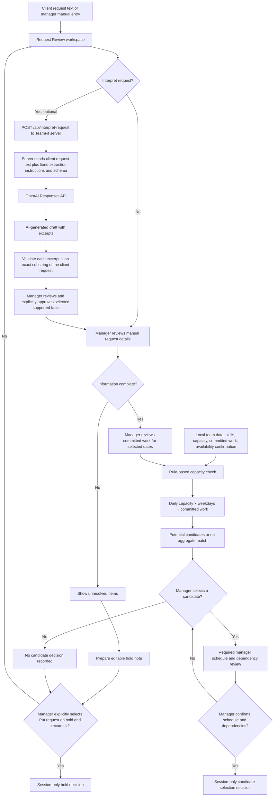

# TeamFit System Diagram

## What the manager must verify

TeamFit can identify potential candidates from rule-based aggregate capacity, but it does not assign work or establish that a client request can be accepted. Before recording a candidate-selection decision, the manager must verify the person's schedule, leave, time blocks, dependencies, and ability to complete the required work before the deadline. The manager must also confirm the request details and committed work for the selected date range.

## Data boundary

OpenAI interpretation is optional. When the manager chooses it, TeamFit sends only the pasted client request text plus fixed extraction instructions and a schema. The server keeps the API key server-side. Team data and capacity information remain local and are not sent to OpenAI.
